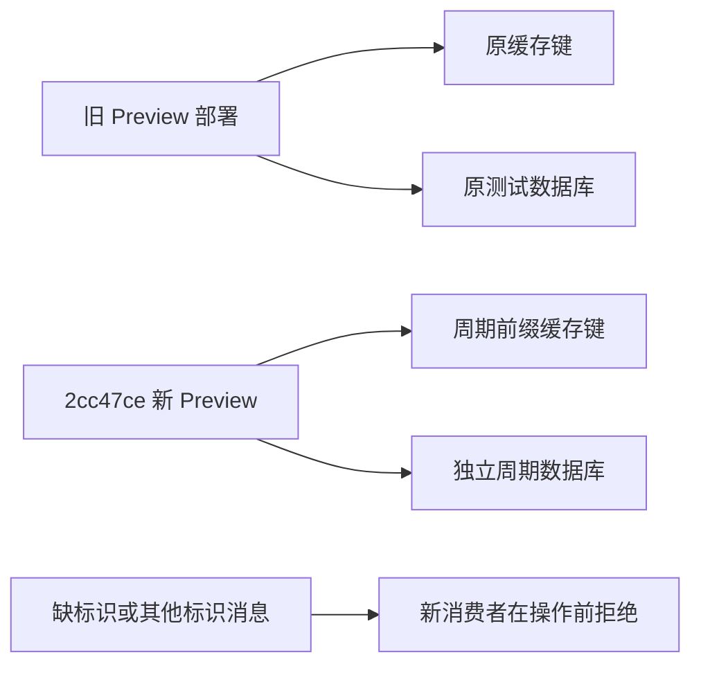

# Preview 旧消息隔离与新版完整周期验收

更新：2026-11-06（Asia/Shanghai）。用户选择「仅 Preview：隔离旧队列并验收新版周期」，Production 保持不变。

## 结论与版本依据

**隔离和新版完整 Queue → 数据库 → API → 浏览器链路验收通过，来源覆盖仍降级，不能提升 Production。** 本轮只手动触发一次真实深度周期，没有人工发布快照、伪造健康状态或用202响应代替运行结果。

远端 main 已只读核对为 `3216fd940dabfa7714383b6436908f9b72ff8a9c`；隔离分支验收前文档提交为 `737c4df`，实际可执行代码固定为下述 `2cc47ce`。本报告以仓库当前[验收合同](action-radar-acceptance-contract.md)为准，旧策略文档仅保留研究背景。收尾提交增加证据、文档及真实生产者消息测试，不改变已部署应用代码。

## 代码与隔离目标

- 代码 `2cc47ce5cae29f8eed57b411e647ccc356372719`，工作树 `/workspace/MedicalChannelAI-p0`，分支 `codex/p0-reliability-contracts`。
- Preview `dpl_8oRuWziEBXmq1wKfVxZTSUosErYG`，<https://medicalchannelai-p1uolbsrn-rerisse7-1717s-projects.vercel.app>，READY，状态接口精确确认代码版本和周期标识。
- 标识 `mcai-p0-20261106-a`；独立数据库 `mcai_p0_epoch_20261106a`，仍在原测试分支 `br-cold-tooth-a5clhljh`，未复制旧测试库。
- 旧部署和旧库保留作证据，不声称旧消费者已经停止；它们仍按原环境运行，新周期的数据、缓存和凭据与其分离。

原 Runtime Cache 可跨部署保留，不能把新部署ID当作缓存隔离。新增仅在 Preview 显式启用的标识：Python全部缓存入口、Node快照/发现缓存的读写、删除及标签均加前缀；调度/ledger/staging/barrier/健康和区域canonical键均覆盖。Production与未启用标识的旧部署保持原键规则。

所有新发送消息带周期标识，幂等键也分开；新消费者对缺标识或其他标识的消息，在缓存、租约、网络请求和发送消息之前返回。已有合法深度/增量租约规则继续适用。原Topic保持平台注册一致，不伪造Queue签名或新增测试入口。

Preview数据库配置需同时指定期望库名，并在构建及服务器连接前校验，防止只隔离缓存却继续写旧库。新角色是限定数据库的read_write角色，不属于neon_superuser；仅在新库public schema补CREATE以运行既有建表逻辑。实测该角色不能读旧快照表，也不能在旧库public schema建表。

## 完整周期实测

| 验证项 | 本轮结果 |
|---|---|
| 执行时间 | 北京时间12:11:40接受，13:18:15发布完成；响应至完成3995.251秒（约66分35秒），不是P95 |
| 终态 | 25阶段：8 COMPLETED、17 DEGRADED；publish一次完成，active_cycle_id=null |
| 来源健康 | 7/14；CCGP、TEDA及北京/河北/辽宁/吉林/黑龙江共7个逻辑来源失败；17降级阶段不等于17个故障来源 |
| 权威数据 | canonical 923、当前池8、Today 5、事件0；durable=true，cache READY |
| 精确时钟 | JSON `2026-11-06T12:11:39.984178+08:00`；SQL `2026-11-06 04:11:39.984178+00`，精确同一时刻 |
| 完整JSON一致性 | Queue SHA、Neon payload重算、强制authority GET、普通浏览器GET均为 `95c7d41525212f3758e50579550fadc8b2034b78a16443d89390b09b35de9361` |
| 浏览器 | 6/6：普通完整池、代码/周期/数据库、ALL 8/8、真实降级提示、390px无横溢、无页面错误或意外请求；4次自动cache_only AI请求被测试护栏阻断，未调用模型 |
| 本地回归 | 889个Python、全部JS合约、TypeScript、Vite通过；主JS gzip116.00kB。补强完整真实生产者消息后，再跑全部889个Python仍通过 |

完整证据及逐文件SHA见[冻结清单](validation/preview-epoch-2026-11-06/manifest.json)；[终态](validation/preview-epoch-2026-11-06/deep-terminal.json)、[数据库及JSON证明](validation/preview-epoch-2026-11-06/publication-proof.json)、[浏览器记录](validation/preview-epoch-2026-11-06/browser-smoke-report.json)分别保留运行与展示边界。

### 来源与依赖行为

- 政府采购网10次发现成功，26候选中选12条核验，暂存合并68条；watch为8个项目。event1两次失败，只有 `EVENT_WATCH_VERIFICATION_INCOMPLETE` 聚合原因，无底层明细；event2至6依赖终局后直接降级。12条新事实没有作为不完整来源事务发布，最终沿用bootstrap的56条CCGP canonical；不能因ccgp发现阶段COMPLETED就标整个来源成功。
- tjmugh选1核1，tjnothop成功扫描0候选；tjzyefy选8核8，intent选2得到1条医疗事实+1条不支持，tjzxfc选5得到1条事实+4条非医疗设施排除，三源deferred均0；tjfch继续完成。这些是本次核验数，不是全库净新增数。
- TEDA实际HTTP403，一次即非重试降级。五地区均实际RATE_LIMITED，每次发现只发1条查询后止损；每地区两次实际尝试，耗尽后fallback直接依赖降级，无额外网络扫描。
- 新版12:15、12:30、12:45、13:00、13:15日内tick实际进入 `DEFERRED_BY_DEEP_CYCLE`；已看到独立tick到达及深度/增量互斥，没有据此宣称深度结束后的SourceJob成功或持续调度通过。

### 新旧隔离与数据范围

启动前新库0表，应用建表后0条快照，新采集状态为空。旧触发凭据403、旧发布凭据401，拒绝后仍为空；无标识/其他标识消息的行为测试使用真实生产者完整消息，仅改变或删除标识，确认在缓存、租约、网络和消息发送之前退出。该负例为本地行为验收，未向平台伪造投递。

12:52数据库对照中，旧库已有12:45的46条版本，新库仍0条；发布后再次对照，旧库继续更新至13:15的46条（SQL仍截断），新库已独立提交12:11的逻辑版本。即使旧库版本时钟更晚，也没有造成新周期回退冲突或数据覆盖。见[运行中对照](validation/preview-epoch-2026-11-06/concurrent-database-isolation.json)和[发布后数据库对照](validation/preview-epoch-2026-11-06/final-database-comparison.json)。旧消费者未停止或删除。

本轮是从仓库bootstrap和本次真实扫描建立的新隔离验收集，没有迁移旧运行缓存/最新数据库快照。923是合并保留的canonical总量，不是本轮新增；8条池含失败来源保留的旧已核验记录，页面明确显示覆盖异常。与旧库46条的差异不能记作迁移丢失，也不能记作覆盖完整；生产迁移、旧数据回补及覆盖对齐均未验收。

### 观察端与脚本边界

首次脚本把旧发布凭据拒绝也误设为403，已按API合同改为401；无cookie的独立PUT返回保护层307，不作为应用鉴权证明。中途观察器累计8次读取错误，探针确认保护层401；刷新本任务临时访问后恢复200，具体提供方机制未知。辽宁第二次实际运行发生于读取中断期间，Queue没有重启；末段观察器的空错误数组不抹去此前中断。详见[观察说明](validation/preview-epoch-2026-11-06/monitor-access-note.json)。

ego-browser在当前Linux不可用，使用隔离Chromium/Playwright、Asia/Shanghai时区、普通GET验收；没有访问账户、触发额外采集/发布或调用真实AI。本任务新旧探测临时分享链接均已撤销，保留项目SSO保护及新版Queue所需的Preview配置。

## 方案判断与下一轮优先级

官方事实核验、失败保留旧数据、分源健康和先Preview验证的方向继续保留。以下问题有本次实测依据，尚未在本轮扩展修复：

1. **非空事件诊断缺失**：持久化有界的失败阶段、固定原因计数及哈希引用；补正反例与真实非空链路验收。没有证据前，不把失败归因于某个网络、字段或解析器。
2. **重试收尾多等一次投递**：五地区第二次失败后分别又等待301.777至302.073秒才降级，合计约25分10秒；应在预算耗尽后安全降级并推进，保持幂等和租约约束。见[重试耗时](validation/preview-epoch-2026-11-06/retry-tail-profile.json)。
3. **同入口限流仍逐地区重复**：按实际请求域名/入口共享预算与冷却，保留明确重试时刻及覆盖缺口；缓存/数据隔离不消除旧部署对同一官方站点的请求竞争。不要用并发扇出、加重试或绕过访问限制解决。
4. **全周期串行发布拖延可用事实**：tjmugh已完成后仍等3190.119秒（约53分10秒）才对外发布；评估每源独立提交、显式来源水位及回补。CCGP事实与更正/终止事件仍应作为同源一致事务，不以独立发布为由放开部分核验。

非空事件成功、全部来源恢复、完整历史召回、持续tick、覆盖迁移、真实模型、国内P95及客户相关性/资格均未完成。`production_ready=false`。Production仍为 `3216fd9` / `dpl_4LPKoTdusrvbExXuzbMKtnyiT86C` READY，SSO不变；没有合并、提升Production或修改域名/DNS/EdgeOne。
