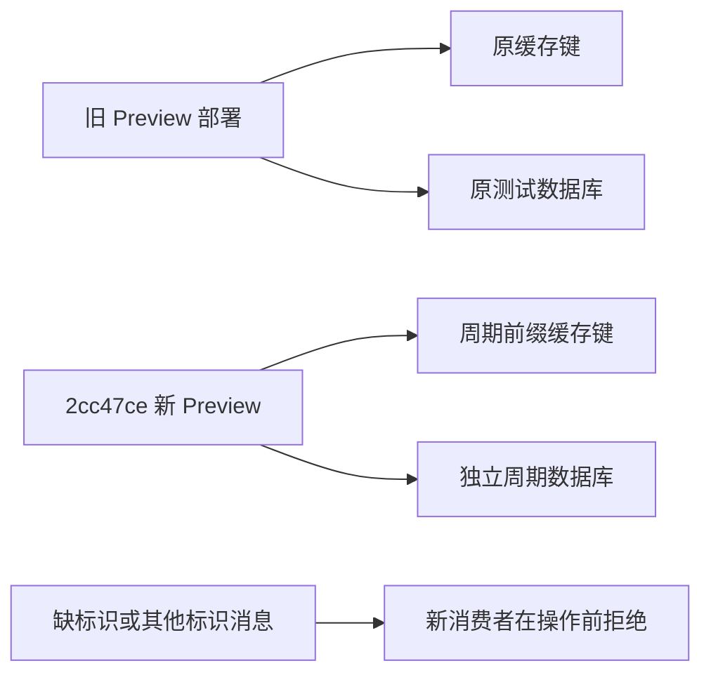

# Preview 旧消息隔离与新版完整周期验收

更新：2026-11-06（Asia/Shanghai）。用户选择「仅 Preview：隔离旧队列并验收新版周期」，Production 保持不变。

## 当前状态

真实新版周期运行中，尚未放行。代码、本地回归和启动隔离检查已完成，权威发布及浏览器结果须等待真实周期结束后补齐，不能将202作为完整验收通过。

## 代码与隔离目标

- 代码 `2cc47ce5cae29f8eed57b411e647ccc356372719`，工作树 `/workspace/MedicalChannelAI-p0`，分支 `codex/p0-reliability-contracts`。
- Preview `dpl_8oRuWziEBXmq1wKfVxZTSUosErYG`，<https://medicalchannelai-p1uolbsrn-rerisse7-1717s-projects.vercel.app>，READY，状态接口精确确认代码版本和周期标识。
- 标识 `mcai-p0-20261106-a`；独立数据库 `mcai_p0_epoch_20261106a`，仍在原测试分支 `br-cold-tooth-a5clhljh`，未复制旧测试库。
- 旧部署和旧库保留作证据，不声称旧消费者已经停止；它们仍按原环境运行，新周期的数据、缓存和凭据与其分离。

原 Runtime Cache 可跨部署保留，不能把新部署ID当作缓存隔离。新增仅在 Preview 显式启用的标识：Python全部缓存入口、Node快照/发现缓存的读写、删除及标签均加前缀；调度/ledger/staging/barrier/健康和区域canonical键均覆盖。Production与未启用标识的旧部署保持原键规则。

所有新发送消息带周期标识，幂等键也分开；新消费者对缺标识或其他标识的消息，在缓存、租约、网络请求和发送消息之前返回。已有合法深度/增量租约规则继续适用。原Topic保持平台注册一致，不伪造Queue签名或新增测试入口。

Preview数据库配置需同时指定期望库名，并在构建及服务器连接前校验，防止只隔离缓存却继续写旧库。新角色是限定数据库的read_write角色，不属于neon_superuser；仅在新库public schema补CREATE以运行既有建表逻辑。实测该角色不能读旧快照表，也不能在旧库public schema建表。

## 已完成验证

- 889个Python测试、全部JS合约、TypeScript、Vite完整构建通过，主JS gzip116.00kB；独立行为用例覆盖跨标识读写/删除/标签、旧消息无副作用、发送标识与幂等性、非法配置及Production兼容。
- 构建先校验真实标识和数据库配置；通用旧回归在子进程中清除该新配置，专用隔离用例显式启用，避免把旧内存fixture误当生产缓存。子进程不改变实际部署环境。
- 新库最初0表，应用建表后0条已提交快照；新采集状态为空。没有人工复制快照、清空旧状态或构造健康时钟。
- 旧触发凭据收到403，旧发布凭据收到401，尝试后新采集状态仍为空。首次脚本错误地将发布拒绝也期望403，已按API规范改正；无cookie的单独PUT曾到达保护层307，不计为应用授权证据。
- 北京时间12:11:40接受真正Queue任务，cycle ID为 `preview:mcai-p0-20261106-a:2026-11-06`，绑定上述不可变部署；只触发一次。

## 本次已观察到的来源结果

政府采购网10次发现查询成功，12条事实核验成功，合并暂存68条，事件watch为8。第一批非空事件核验两次失败，只保留聚合原因 `EVENT_WATCH_VERIFICATION_INCOMPLETE`，底层明细尚未持久化，不能推断具体网络或字段原因。当前尚未完成该来源的完整事务，不把12条暂存核验事实当作已公开提交。

该非空事件链与此前空watch验收不同；最终是否降级、依赖是否正确跳过、其他来源是否继续及权威是否发布，均待实际运行收尾。

## 完整发布与收尾

待真实周期结果、隔离数据库完整JSON与精确时间、普通用户GET和浏览器证据写入。
